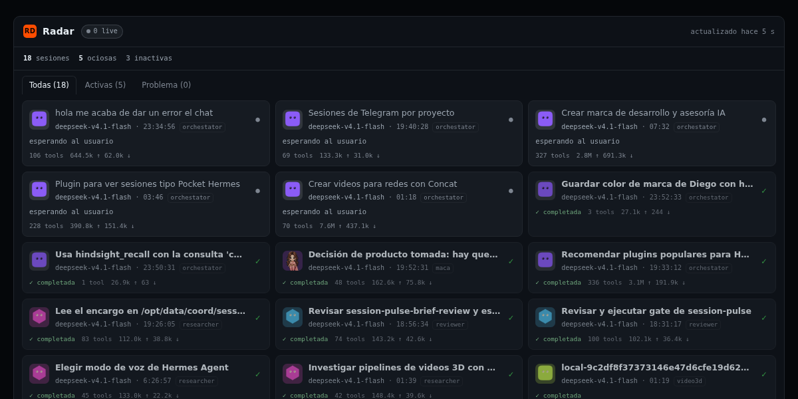

# Radar

**htop for Hermes sessions.** A live, compact view of every Hermes session,
across every profile: what the agent is doing right now, in which session and
profile, with which model, for how long, whether it is **waiting for you**, and
whether something is stuck. A floating card (S/M/L/XL, 320 × 214 by default)
is the quick view; a resizable 380 px right side panel is the full, filterable
view. A hung turn can be stopped in two clicks from either one.

Radar keeps no history of its own: it reads the current state of each
profile's `state.db` on every refresh.



> Real capture of the web mirror (`/view`), 2:1 (1200 × 600) for the catalog
> `image:` field, 24 h window. The same page supports `?theme=light`
> (`docs/view-light.png`); it is the same markup with the light token set.
> The Desktop half renders the same payload twice: the floating card (S/M/L/XL)
> is the quick view, and the 380 px right panel is the full panel with grouped
> rows, filters and settings. `docs/view-waiting.png` is the same page with the
> **Esperan** tab selected, so every amber «espera» row is on screen.

## What it does

* Discovers the root Hermes home (`state.db`) and every named profile
  (`profiles/<name>/state.db`).
* Classifies each session from its turn lease, admissions queue, async
  delegation state and last activity.
* Shows the in-flight tool (the last `assistant` message with `tool_calls` and
  no matching tool result), falling back to `last_activity_description`.
* Serves three surfaces from one backend:
  * `GET /live` — JSON snapshot.
  * `GET /view` — self-contained HTML mirror (no CDN, no build step).
  * `GET /avatar/{profile}` — the profile's real PNG avatar as a data URL.
* Paints the **real bot avatar**, not a generic initial: the same
  `assets/avatar.png` the Bots roster shows, clipped to the profile's stored
  silhouette, plus its `ui_meta['hermes-bots']` title, shape and color.
* Ships a Desktop half (`desktop/plugin.js`) with three integrated surfaces plus Always-on-Top:
  * `radar` — the floating quick view (`placement: 'floating'`, anchored
    bottom-right) at one of four sizes, S 320 × 214 by default, one compact row
    per session.
  * `radar:panel` — the full 380 px right panel (`placement: 'right'`) with
    grouped rows, filter tabs, large counters, settings, row actions and the
    profile's real avatar.
  * `nav` (`sidebar.nav`) + `page` (`routes` at `/radar`) — **Left Sidebar**
    navigation entry (`Radar` with `pulse` icon) that opens a full-page
    multi-column Radar workspace with instant search, counters, and right-click
    *Open in split* support.
  * **📌 Siempre encima (Always-on-Top Picture-in-Picture)** — 1-click native
    Chromium Picture-in-Picture mini-window (`canvas.captureStream` →
    `video.requestPictureInPicture()`) that floats on top of all OS windows even
    when Hermes Desktop is minimized.
* Emits `plugin.radar.changed` at most once every 2 s, and only when
  the visible snapshot changed.

## States

| State | Meaning |
| --- | --- |
| `running` | A turn lease is live, or an async delegation is still in flight. |
| `stalled` | The lease expired while the session was active in the last 30 minutes, or an open row recorded a failing `end_reason` without an `ended_at`. Needs attention. |
| `queued` | An admission is waiting in the queue for that session. |
| `idle` | No live lease, but activity happened inside the requested window. Waiting on the user; painted amber as **espera**. |
| `dormant` | No live lease and activity outside the window. Counted as `inactivas`, never listed. |
| `done` / `failed` | The session has a terminal `end_reason` inside the window. |

`dormant` is not `stalled`: an abandoned session from last week is history, not
a hung turn now. Only a recent expired lease paints red.

## The Desktop panes

### Quick view — `radar` (floating, S/M/L/XL)

* Header: `S · M · L · XL` (320 × 214, 420 × 300, 520 × 380, 620 × 460), the
  active one highlighted and remembered as `radar.size`. The same header has a
  `⤢` button that reveals the full side panel (`host.revealPane`, when the host
  exposes it). Choosing a size re-registers the pane by id: same body, new
  `width`/`height`.

* One compact row per session in panel order: `running` → `stalled` → `queued`
  → `idle` → `done` → `failed`. `dormant` is never listed.
* Idle rows carry an amber **espera** badge and an amber left edge: the turn
  ended and the user is awaited. Stalled rows stay red (`!`).
* Footer: `N trabajando · M esperando · K colgadas` plus `hace Xs`, or
  `sin conexión` when the last fetch failed (the previous snapshot stays on
  screen). A profile that could not be read is named there too:
  `sin conexión · <perfil>`.
* Click a row to open that session (`host.openSession`). A running or stalled
  row exposes **parar**: the first click asks `¿seguro?`, the second sends
  `session.interrupt`.

### Full panel — `radar:panel` (right, 380 px)

* Tiles into the Desktop's **right sidebar** role: use the right-sidebar
  toggle to show or hide it. It is the full panel; the floating card stays the
  quick view.
* Three large counters in the header: **trabajando**, **esperando** and
  **colgadas**. `esperando` turns amber and `colgadas` red only when they are
  above zero. Clicking a counter selects the matching filter.
* Filter tabs **Todas · Trabajando · Esperan · Problema**, each with its count.
  The chosen filter is stored as `radar.filter` and restored on mount.
* Grouped list with a header and count per group: **Trabajando**
  (`running` + `queued`), **Esperando** (`idle`), **Colgadas** (`stalled`) and
  **Terminadas** (`done` + `failed`, hideable).
* Every row shows the 30 px profile avatar, the session title, the
  `profile_title` badge, the current tool/activity line, the last-activity time
  (`hace …`, falling back to elapsed) and three actions: **open**, **parar**
  (running/stalled only) and **copiar** the session id (`copiado` confirms for a
  moment).
* Settings in **Ajustes**, persisted through the verified `ctx.storage` API
  under `radar.*`:
  * Perfiles: `Todos` / `Solo el actual` (`radar.profiles`).
  * Ventana: `1 min` / `3 min` / `10 min` (`radar.window`).
  * Mostrar terminadas: sí / no (`radar.finished`).
  * Densidad: compacta / cómoda (`radar.density`).
  The panel requests `/live?profiles=all|current&window=60|180|600` from those
  values.
* Both panes share the stop fence: before sending the interrupt they re-read
  `/live` with their current query and abort when the row disappeared, left
  `running`/`stalled`, or advanced to another `execution_generation`. That is
  the real fence: `session.interrupt` does not inspect generations itself.
* Stalled rows say how long the heartbeat has been missing
  (`sin latido hace 12 min`), not just `sin latido`.
* Every colour derives from the Desktop theme tokens (`--dt-foreground`,
  `--dt-muted-foreground`, `--dt-destructive`) through `color-mix()`, so the
  avatar initial, the amber waiting state and the red stalled state stay
  legible in light and dark skins.
* Each pane refreshes every 2 s while it is mounted and listens to
  `plugin.radar.changed` with a 500 ms debounce. Both are deliberately
  registered without `lifecycleKeepAlive`: collapsing or closing a pane
  unmounts the body, and the poll stops with it. `host.paneVisibility('radar')`
  is always `false` for a floating pane (it is not in the layout tree), so it is
  not used as a refresh gate.

## API

Mounted by the gateway under `/api/plugins/radar/`.

| Endpoint | Description |
| --- | --- |
| `GET /live?profiles=all\|current\|<list>&window=180` | Snapshot JSON. `profiles` accepts `all`, `current` or a comma-separated list. `window` is seconds (15–86400). |
| `GET /view?profiles=...&window=...&theme=dark\|light&tab=all\|working\|waiting\|problem` | HTML mirror of the same view, refreshing every 2 s. The page embeds the profile list already resolved by `select_profiles()`, never the raw query, so the selector cannot inject markup. `theme` only switches the palette; `tab` only selects the initial tab. Both are validated against closed sets. |
| `GET /avatar/{profile}` | `{"data_url": "data:image/png;base64,..."}`, or `{"data_url": null}` when the profile has no image. Only names returned by `discover_profiles()` are served, the file is always `<profile>/assets/avatar.png` (`$HERMES_HOME/assets/avatar.png` for the root), the PNG signature is validated and files over 512 KB are refused. Unknown or traversal-shaped names return 404. |

Example payload:

```json
{
  "generated_at": 1793853258,
  "profiles": ["default", "maca"],
  "window_s": 180,
  "sessions": [
    {
      "id": "20261105_030552_19a2c2",
      "profile": "default",
      "profile_label": "default",
      "profile_title": "orchestator",
      "avatar": {
        "has_image": true,
        "shape": "blobatar",
        "color": "#ff4d00"
      },
      "title": "Plugin para ver sesiones",
      "model": "deepseek-v4.1-flash",
      "state": "running",
      "activity": "terminal",
      "tool": "terminal",
      "since": 1793853041,
      "last_activity_at": 1793853041,
      "elapsed_s": 216,
      "messages": 77,
      "tools": 46,
      "tokens_in": 102789,
      "tokens_out": 31273,
      "cost_usd": 0.0,
      "cwd": "/home/user/project",
      "git_branch": "main",
      "parent_id": null,
      "source": "desktop",
      "stalled": false,
      "waiting_for_user": false,
      "waiting_reason": "",
      "can_interrupt": true,
      "execution_generation": 4,
      "delegating": 0
    }
  ],
  "totals": {
    "running": 1, "queued": 0, "stalled": 0, "idle": 4,
    "done": 0, "failed": 0,
    "working": 1, "waiting": 4,
    "live": 1, "dormant": 7, "sessions": 5
  }
}
```

* `profile_title` is `ui_meta['hermes-bots'].title`, else the profile's
  `display_name`, else the profile name. The badge renders this, never the slug.
* `avatar` carries only metadata: `/live` never inlines the image. `shape` and
  `color` come from `ui_meta['hermes-bots']`; a missing color is derived from the
  profile name with the same 31-multiplier hue hash the Desktop SDK uses, and
  the root profile stays neutral. Both are cached by file `mtime`/size.
* `waiting_for_user` is `true` exactly for `state === "idle"`: no lease is live
  and the activity is inside the window, so the turn ended and the user is
  awaited. `waiting_reason` carries that row's `activity` text (or `""` when
  there is none) and is always `""` for every other state.
* `totals.working` is `running + queued`; `totals.waiting` is `idle`. Every
  per-state counter (`running`, `queued`, `stalled`, `done`, `failed`, `live`,
  `dormant`, `sessions`) is unchanged.
* `can_interrupt` is `true` for `running` and `stalled` only. A queued request is
  cancelled through the admission API, not interrupted.
* `execution_generation` mirrors `sessions.runtime_generation` and is `null`
  when the column does not exist. The Desktop re-reads `/live` immediately
  before `session.interrupt` and aborts if the row disappeared, is no longer
  `running`/`stalled`, or reports a different generation. The RPC itself does
  not check the generation: the fence is client-side, and there is no retry.
* `delegating` counts `async_delegations` rows still in flight for that session.
* `profile_errors` appears only when a profile database could not be read
  (locked, corrupt, missing tables); the rest of the snapshot is unaffected.
* Rows are ordered by state, then by `elapsed_s` descending.

## Disclosure

Read this before installing:

* **Reads every profile's `state.db`, read-only.** Each file is opened through a
  SQLite read-only URI (`mode=ro`) with `PRAGMA query_only = ON`. The plugin
  never writes, creates or migrates a database. It reads session rows, turn
  leases, admissions, async delegations and a bounded lookup in `messages` for
  the in-flight tool call.
* **Can interrupt any session's turn, in any profile.** The stop button sends
  the gateway RPC `session.interrupt`, which cancels the running turn. This is
  a real state change, not a read; it requires two clicks in the panel and is
  never automatic. For a session owned by another profile, the Desktop routes
  the RPC through that profile's route descriptor and refuses (`sin ruta al
  perfil …`) rather than guess.
* **No network access from the plugin, no telemetry, no credentials.** Nothing
  leaves the machine and no secret file is read. The stop travels over the
  already-open Desktop gateway socket.

The manifest says exactly this: `radar` is a read-only observer of
SQLite state **and** a gateway client that can stop a turn. It declares no
capabilities of its own.

## Installation

Requirements: Hermes **>= 0.22**, the Desktop app for the floating pane, and a
Unix-like or Windows host. See [Platforms](#platforms).

### From the catalog

```bash
hermes plugins search radar
hermes plugins install radar --enable
```

The catalog install picks up the unified package: the dashboard backend and the
`desktop/plugin.js` half.

### From Git

```bash
hermes plugins install https://github.com/Dieguezar/hermes-radar --ref <40-char-sha> --enable
```

### Manual

Unified package (backend + Desktop half) into the Hermes home:

```bash
git clone https://github.com/Dieguezar/hermes-radar \
  "$HERMES_HOME/plugins/radar"
```

Desktop half only (no backend, no `/view`) into the Desktop plugin door:

```bash
mkdir -p "$HERMES_HOME/desktop-plugins/radar"
cp desktop/plugin.js "$HERMES_HOME/desktop-plugins/radar/plugin.js"
```

Then make sure the plugin is enabled in `config.yaml`:

```yaml
plugins:
  enabled:
    - radar
```

Restart the gateway only if it was already running (the dashboard backend
mounts at gateway startup); the Desktop half loads at app startup. Session
Radar registers no tools, hooks, middleware or commands.

## Platforms

* **Linux** — supported and verified here.
* **Windows** — supported by design, verified on Linux. Every path goes through
  `Path.as_uri()` (drive form `file:///C:/...`), and the SQLite fallbacks cover
  Windows locks: if the open fails with a `-wal` sidecar present,
  `mode=ro&readonly_shm=1` is used. There is no Windows execution in this
  release; treat it as argued, not proven.
* **macOS** — not tested by this release; it is not declared in the manifest.

## Limits

* **No history.** Radar persists nothing; closing the panel loses the
  view.
* **Floating pane vs. Always-on-Top PiP.** `placement: 'floating'` is a
  renderer-level card inside the Hermes workspace; minimizing Hermes to the OS
  hides that card. To keep watching sessions while Hermes is minimized, click
  **📌 Siempre encima** (`sp-pip`) in any Radar surface (or `/view`) to pop out
  the native Chromium Picture-in-Picture Always-on-Top overlay window.
* **`placement: 'floating'` is not in the public SDK doc.** The renderer
  implements it (`floating-panes.tsx`) and the type is exported
  (`sdk/index.ts`), and `hermes plugins validate` accepts it, but a public
  documented flag is not the same guarantee. Re-verify on a Desktop upgrade.
* **Bounded scans.** At most 200 sessions per profile, one `LIMIT 1` tool
  lookup per visible active session (cached 6 s, purged on write), and no full
  `messages` scan. The change watcher stops itself after 60 s without `/live`
  requests and the next request relaunches it.
* **Hidden sessions are excluded.** Rows with `hidden = 1` are not listed.
* **WAL reads.** A WAL database in `mode=ro` needs its `-shm`/`-wal` sidecars
  while a gateway is writing. If the primary open fails and there is no `-wal`
  sidecar, Radar retries with `?mode=ro&immutable=1`; on Windows it
  retries with `?mode=ro&readonly_shm=1`. A profile that still cannot be read
  is skipped and reported in `profile_errors`.
* **Costs** come from `sessions.estimated_cost_usd`; profiles that do not
  populate it report `0.0`.

## Local verification (no gateway restart)

```bash
cd ~/projects/hermes-radar

# Backend tests (also runnable with pytest when available)
/opt/hermes/.venv/bin/python tests/test_api.py

# Hermes admission checks
/opt/hermes/bin/hermes plugins doctor .
/opt/hermes/bin/hermes plugins validate .

# Standalone harness (does not touch the live gateway)
/opt/hermes/.venv/bin/python -m uvicorn --app-dir tools devserver:app --port 8791
curl -s 'http://127.0.0.1:8791/api/plugins/radar/live?profiles=all'
curl -s -o /dev/null -w '%{http_code}\n' 'http://127.0.0.1:8791/api/plugins/radar/view'
```

Set `RADAR_HOME` to point the harness at another Hermes root;
`RADAR_DISABLE_WATCHER=1` disables the background watcher (used by the
tests).

The Desktop half is checked statically:

```bash
node --input-type=module --check < desktop/plugin.js
hermes plugins validate .    # includes the "desktop surface" rule
```
